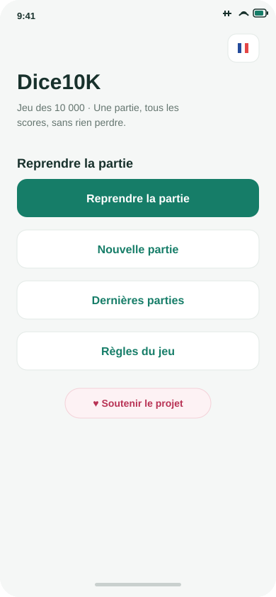
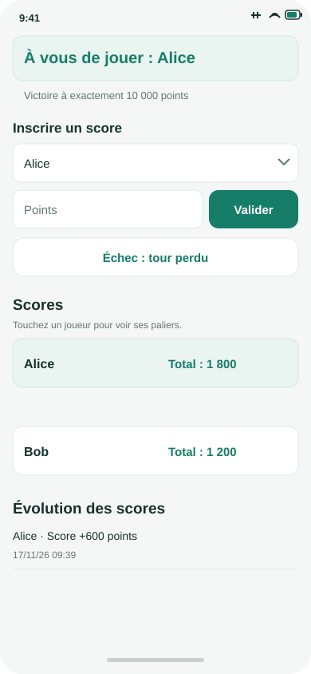
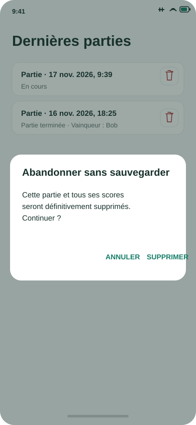

<p align="center">
  <a href="./README.md">🇬🇧 English</a> ·
  <a href="./README.fr.md">🇫🇷 Français</a> ·
  <a href="./README.es.md">🇪🇸 Español</a> ·
  <a href="./README.it.md">🇮🇹 Italiano</a> ·
  <strong>🇩🇪 Deutsch</strong>
</p>

<p align="center">
  
</p>

<h1 align="center">Dice10K</h1>

<p align="center">
  <strong>Die freie, schlanke und 100 % offline nutzbare Android-App zum Punktezählen beim Würfelspiel Zehntausend (Farkle / Zilch).</strong>
</p>

<p align="center">
  <a href="https://github.com/furcy75/Dice10k/releases/latest">
    
  </a>
  <a href="https://github.com/furcy75/Dice10k/actions/workflows/build-release.yml">
    
  </a>
  <a href="./LICENSE">
    
  </a>
  
  
</p>

<p align="center">
  <a href="https://github.com/sponsors/furcy75">
    
  </a>
</p>

<p align="center">
  <a href="#-apk-herunterladen--installieren">APK herunterladen</a> ·
  <a href="#-vorschau">Vorschau</a> ·
  <a href="#-funktionen">Funktionen</a> ·
  <a href="#-unterstützte-regeln">Regeln</a> ·
  <a href="#-aus-dem-quellcode-kompilieren">Kompilieren</a> ·
  <a href="#-mitwirken">Mitwirken</a> ·
  <a href="#-projekt-unterstützen">Unterstützen</a>
</p>

---

**Dice10K** begleitet eure echten Würfelrunden (*Zehntausend* / *Farkle* / *Zilch*) am Tisch. Ihr würfelt mit echten Würfeln und tragt die Punkte ein: Die App verwaltet automatisch Gesamtpunkte, den 600-Punkte-Einstieg, Punktestufen, die 3-Fehlwürfe-Regel, kaskadierenden Punktediebstahl bei Gleichstand und den Sieg bei **genau 10.000 Punkten**.

- **Ultraleicht**: ~50 KB, reines natives Android-Java ohne externe Abhängigkeiten.
- **Datenschutz zuerst**: **keinerlei Android-Berechtigungen**, keine Werbung, kein Tracking, 100 % offline.
- **Freie Software**: Open Source unter GNU GPL v3.

---

## 📥 APK herunterladen & installieren

<p align="center">
  <a href="https://github.com/furcy75/Dice10k/releases/latest">
    
  </a>
</p>

### Direkte Installation auf Android
1. Öffne die Seite **[Releases](https://github.com/furcy75/Dice10k/releases/latest)** und lade `Dice10K-v*.apk` herunter.
2. Tippe auf dem Smartphone auf die heruntergeladene Datei.
3. Falls Android danach fragt, erlaube die Installation aus dieser Quelle (*„Unbekannte Apps installieren“*).
4. *(Optional)* Prüfe die Dateiintegrität mit der beiliegenden `.sha256`-Prüfsumme.

### Installation über ADB (Computer)
```sh
adb install -r Dice10K-v1.1.0.apk
```

---

## 📱 Vorschau

<p align="center">
  
  
  
</p>

---

## ✨ Funktionen

| Funktion | Details |
|---|---|
| **2 bis 8 Spieler** | Schnelle Auswahl der Spieleranzahl und freie Namensvergabe. |
| **Vollständige Zugerfassung** | Punkte eintragen, Fehlwurf erfassen oder manuell korrigieren (negative Punkte). |
| **Stufen & 3-Fehlwürfe-Regel** | Automatische Fehlwurf-Kreuze je Stufe und Abzug der Stufe beim 3. Fehlwurf. |
| **Kaskadierender Punktediebstahl** | Bei genauem Gleichstand verliert der Gegner seinen letzten Gewinn – inklusive Kaskaden-Auflösung und Übersicht. |
| **Exakter Sieg bei 10.000** | Über 10.000 zählt als Fehlwurf; bei genau 10.000 wird das Spiel abgeschlossen und der Sieger angezeigt. |
| **Verlauf & Fortsetzen** | Laufende Spiele sofort fortsetzen, Stufendetails je Spieler ansehen, Einträge rückgängig machen und alte Spiele verwalten. |
| **5 integrierte Sprachen** | Automatische Erkennung der Systemsprache + schneller Sprachwechsel: **Français, English, Español, Italiano, Deutsch**. |
| **100 % offline** | Lokale SQLite-Datenbank, keine Internetverbindung nötig. |

---

## 📜 Unterstützte Regeln

- **600-Punkte-Einstieg**: Mindestens **600 Punkte in einem Zug**, um ins Spiel zu kommen (oder nach einem Rückfall auf ≤ 0 wieder einzusteigen).
- **Genau 10.000 Punkte zum Sieg**: Wer darüber liegt, verliert die Zugpunkte und erhält einen Fehlwurf.
- **3-Fehlwürfe-Regel**: Fehlwurf-Kreuze gehören zur aktuellen Stufe; beim 3. Fehlwurf werden deren Punkte abgezogen.
- **Gleichstand & Punktediebstahl**: Wer genau den Punktestand eines Gegners erreicht, zieht diesem den letzten erfolgreichen Gewinn ab – bei weiteren Gleichständen als Kaskade.

👉 Die vollständigen Regeln in allen 5 Sprachen findest du in **[REGLES.md](./REGLES.md)**.

---

## 🛠️ Aus dem Quellcode kompilieren

### Voraussetzungen
- **JDK 17** (oder 21)
- **Android SDK** mit **Android SDK Platform 35**

### Befehle
```sh
git clone https://github.com/furcy75/Dice10k.git
cd Dice10k
./gradlew assembleDebug
```

Unter Windows:
```powershell
.\gradlew.bat assembleDebug
```

Die erzeugte APK liegt anschließend unter:
```text
app/build/outputs/apk/debug/app-debug.apk
```

---

## 🔒 Datenschutz

Dice10K fordert **keinerlei Android-Berechtigungen** an (nicht einmal Internetzugriff).
Spielernamen, Punktestände und Verlauf bleiben ausschließlich in der lokalen Datenbank auf deinem Gerät. Der Button *„Projekt unterstützen“* öffnet nur dann deinen Standardbrowser, wenn du ihn selbst antippst.

---

## 💖 Projekt unterstützen

Dice10K ist und bleibt **kostenlos, Open Source und werbefrei**.
Wenn die App eure Spieleabende bereichert und du die Entwicklung unterstützen möchtest:

- ⭐ Gib dem Repository einen **Stern** auf GitHub;
- 💖 Unterstütze über **[GitHub Sponsors](https://github.com/sponsors/furcy75)**;
- 🐛 Melde Fehler, schlage Verbesserungen vor oder hilf bei Übersetzungen!

---

## 🤝 Mitwirken

Beiträge sind herzlich willkommen! Siehe **[CONTRIBUTING.md](./CONTRIBUTING.md)** oder öffne ein [Issue](https://github.com/furcy75/Dice10k/issues) bzw. einen [Pull Request](https://github.com/furcy75/Dice10k/pulls).

---

## 📄 Lizenz

Veröffentlicht unter der **[GNU General Public License v3.0 (GPL-3.0)](./LICENSE)**.
