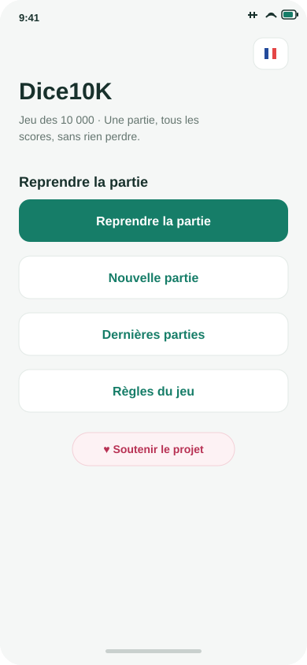
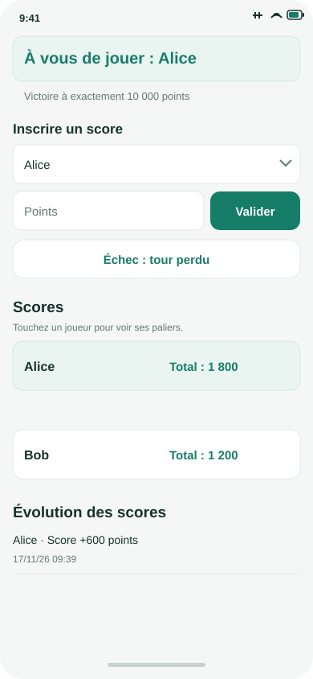
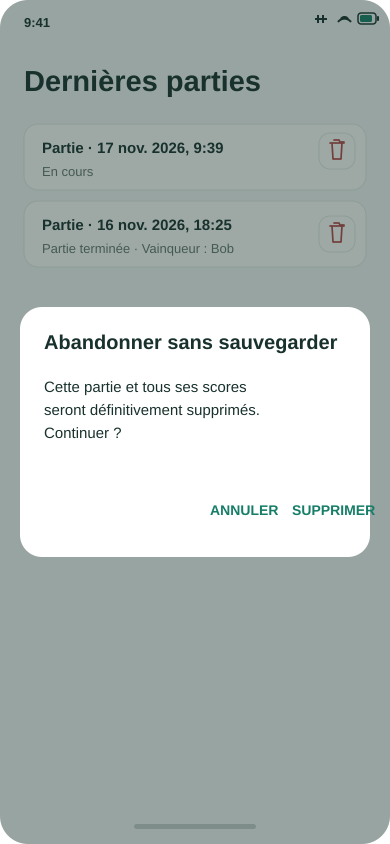

<p align="center">
  <a href="./README.md">🇬🇧 English</a> ·
  <a href="./README.fr.md">🇫🇷 Français</a> ·
  <strong>🇪🇸 Español</strong> ·
  <a href="./README.it.md">🇮🇹 Italiano</a> ·
  <a href="./README.de.md">🇩🇪 Deutsch</a>
</p>

<p align="center">
  
</p>

<h1 align="center">Dice10K</h1>

<p align="center">
  <strong>La aplicación Android libre, ligera y 100 % sin conexión para llevar el marcador del juego de los 10 000 (Farkle / Zilch).</strong>
</p>

<p align="center">
  <a href="https://github.com/furcy75/Dice10k/releases/latest">
    
  </a>
  <a href="https://github.com/furcy75/Dice10k/actions/workflows/build-release.yml">
    
  </a>
  <a href="./LICENSE">
    
  </a>
  
  
</p>

<p align="center">
  <a href="https://github.com/sponsors/furcy75">
    
  </a>
</p>

<p align="center">
  <a href="#-descargar-e-instalar-el-apk">Descargar APK</a> ·
  <a href="#-vista-previa">Vista previa</a> ·
  <a href="#-características">Características</a> ·
  <a href="#-reglas-compatibles">Reglas</a> ·
  <a href="#-compilar-desde-el-código-fuente">Compilar</a> ·
  <a href="#-contribuir">Contribuir</a> ·
  <a href="#-apoyar-el-proyecto">Apoyar</a>
</p>

---

**Dice10K** acompaña tus partidas reales de dados (*Juego de los 10 000* / *Farkle* / *Zilch*). Los jugadores lanzan dados físicos e introducen sus puntos: la aplicación gestiona automáticamente los totales, la apertura de 600 puntos, los niveles, los 3 fallos, el robo de puntos en cascada y la victoria al llegar a **exactamente 10 000 puntos**.

- **Ultraligera**: ~50 KB, escrita en Java nativo para Android sin dependencias externas.
- **Privacidad total**: **cero permisos de Android**, sin anuncios, sin rastreadores y 100 % sin conexión.
- **Software libre**: código abierto bajo licencia GNU GPL v3.

---

## 📥 Descargar e instalar el APK

<p align="center">
  <a href="https://github.com/furcy75/Dice10k/releases/latest">
    
  </a>
</p>

### Instalación directa en Android
1. Entra en la página **[Releases](https://github.com/furcy75/Dice10k/releases/latest)** y descarga `Dice10K-v*.apk`.
2. Abre el archivo descargado desde tu teléfono.
3. Si Android lo solicita, permite la instalación desde esta fuente (*«Aplicaciones desconocidas»*).
4. *(Opcional)* Comprueba la integridad del archivo con la suma `.sha256` incluida en cada lanzamiento.

### Instalación mediante ADB (ordenador)
```sh
adb install -r Dice10K-v1.1.0.apk
```

---

## 📱 Vista previa

<p align="center">
  
  
  
</p>

---

## ✨ Características

| Característica | Detalle |
|---|---|
| **De 2 a 8 jugadores** | Selector rápido de jugadores y nombres personalizables. |
| **Control completo de turnos** | Anota puntos, registra un fallo o realiza correcciones manuales (puntos negativos). |
| **Niveles y regla de 3 fallos** | Seguimiento automático de cruces por nivel y retirada del nivel al 3.er fallo. |
| **Robo de puntos en cascada** | Al igualar exactamente a un rival, pierde su última ganancia y se resuelven nuevos empates en cascada con aviso detallado. |
| **Victoria exacta en 10 000** | Superar los 10 000 anula el turno y cuenta como fallo; al ganar se cierra la partida y se muestra el ganador. |
| **Historial y continuación** | Retoma la partida en curso al instante, consulta los niveles por jugador, deshaz anotaciones y gestiona partidas anteriores. |
| **5 idiomas integrados** | Detección automática del idioma del dispositivo y selector en inicio: **Français, English, Español, Italiano, Deutsch**. |
| **100 % sin conexión** | Base de datos local SQLite, sin necesidad de internet. |

---

## 📜 Reglas compatibles

- **Apertura con 600 puntos**: hay que anotar al menos **600 puntos en un turno** para entrar (o reabrir si el total baja a 0 o menos).
- **Victoria exacta con 10 000 puntos**: superar los 10 000 rechaza los puntos y cuenta como fallo.
- **Regla de 3 fallos**: las cruces pertenecen al nivel actual; al tercer fallo, se quitan los puntos de ese nivel.
- **Empate y robo de puntos**: alcanzar exactamente el total de un rival le quita su último turno exitoso, en cascada si surgen nuevos empates.

👉 Consulta las reglas completas en los 5 idiomas en **[REGLES.md](./REGLES.md)**.

---

## 🛠️ Compilar desde el código fuente

### Requisitos
- **JDK 17** (o 21)
- **Android SDK** con **Android SDK Platform 35**

### Comandos
```sh
git clone https://github.com/furcy75/Dice10k.git
cd Dice10k
./gradlew assembleDebug
```

En Windows:
```powershell
.\gradlew.bat assembleDebug
```

El APK generado se encuentra en:
```text
app/build/outputs/apk/debug/app-debug.apk
```

---

## 🔒 Privacidad

Dice10K no solicita **ningún permiso de Android** (ni siquiera acceso a internet).
Los nombres, puntuaciones e historial permanecen únicamente en la base de datos local de tu dispositivo. El botón *«Apoyar el proyecto»* solo abre tu navegador predeterminado si decides pulsarlo.

---

## 💖 Apoyar el proyecto

Dice10K es y seguirá siendo **gratuito, libre y sin anuncios**.
Si disfrutas de la aplicación y quieres apoyar su desarrollo:

- ⭐ Dale una **estrella** a este repositorio en GitHub;
- 💖 Apoya a través de **[GitHub Sponsors](https://github.com/sponsors/furcy75)**;
- 🐛 Informa de errores, sugiere mejoras o colabora con traducciones.

---

## 🤝 Contribuir

¡Toda contribución es bienvenida! Consulta **[CONTRIBUTING.md](./CONTRIBUTING.md)** o abre una [issue](https://github.com/furcy75/Dice10k/issues) / [pull request](https://github.com/furcy75/Dice10k/pulls).

---

## 📄 Licencia

Distribuido bajo la licencia **[GNU General Public License v3.0 (GPL-3.0)](./LICENSE)**.
