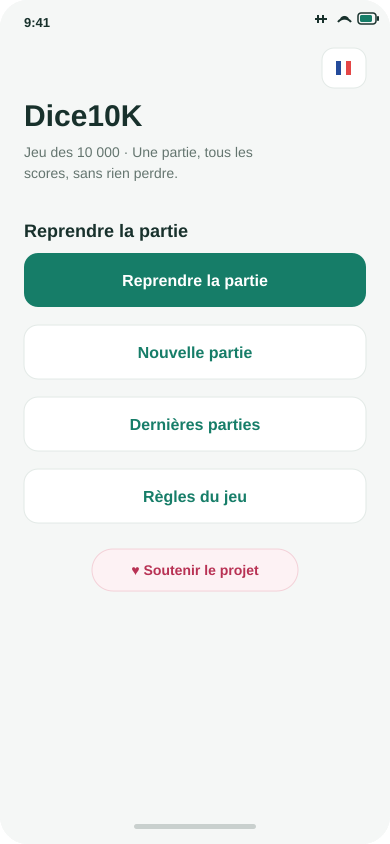
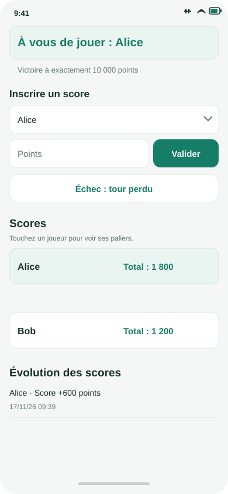
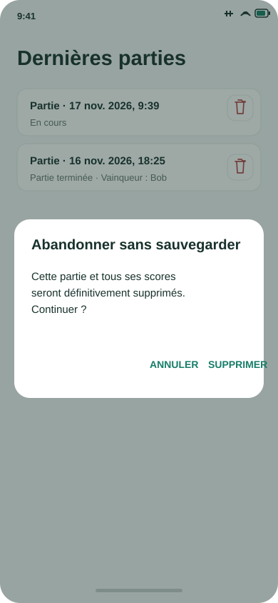

<p align="center">
  <a href="./README.md">🇬🇧 English</a> ·
  <a href="./README.fr.md">🇫🇷 Français</a> ·
  <a href="./README.es.md">🇪🇸 Español</a> ·
  <strong>🇮🇹 Italiano</strong> ·
  <a href="./README.de.md">🇩🇪 Deutsch</a>
</p>

<p align="center">
  
</p>

<h1 align="center">Dice10K</h1>

<p align="center">
  <strong>L’app Android libera, leggera e 100% offline per tenere i punteggi del gioco dei 10.000 (Farkle / Zilch).</strong>
</p>

<p align="center">
  <a href="https://github.com/furcy75/Dice10k/releases/latest">
    
  </a>
  <a href="https://github.com/furcy75/Dice10k/actions/workflows/build-release.yml">
    
  </a>
  <a href="./LICENSE">
    
  </a>
  
  
</p>

<p align="center">
  <a href="https://github.com/sponsors/furcy75">
    
  </a>
</p>

<p align="center">
  <a href="#-scarica-e-installa-lapk">Scarica APK</a> ·
  <a href="#-anteprima">Anteprima</a> ·
  <a href="#-funzionalità">Funzionalità</a> ·
  <a href="#-regole-supportate">Regole</a> ·
  <a href="#-compilare-dai-sorgenti">Compila</a> ·
  <a href="#-contribuire">Contribuire</a> ·
  <a href="#-sostieni-il-progetto">Sostieni</a>
</p>

---

**Dice10K** accompagna le tue partite reali a dadi (*Gioco dei 10.000* / *Farkle* / *Zilch*). I giocatori lanciano dadi veri e inseriscono i punti del turno: l’app gestisce automaticamente i totali, l’apertura a 600 punti, gli scaglioni, i 3 falli, il furto di punti a cascata e la vittoria a **esattamente 10.000 punti**.

- **Ultraleggera**: ~50 KB, scritta in Java Android nativo senza dipendenze esterne.
- **Privacy al primo posto**: **zero permessi Android**, nessuna pubblicità, nessun tracciamento, 100% offline.
- **Software libero**: codice sorgente aperto con licenza GNU GPL v3.

---

## 📥 Scarica e installa l’APK

<p align="center">
  <a href="https://github.com/furcy75/Dice10k/releases/latest">
    
  </a>
</p>

### Installazione diretta su Android
1. Vai sulla pagina **[Releases](https://github.com/furcy75/Dice10k/releases/latest)** e scarica `Dice10K-v*.apk`.
2. Apri il file scaricato dal tuo smartphone.
3. Se Android lo richiede, consenti l’installazione da questa fonte (*«App sconosciute»*).
4. *(Opzionale)* Verifica l’integrità del file con il checksum `.sha256` allegato a ogni release.

### Installazione tramite ADB (computer)
```sh
adb install -r Dice10K-v1.1.0.apk
```

---

## 📱 Anteprima

<p align="center">
  
  
  
</p>

---

## ✨ Funzionalità

| Funzionalità | Dettaglio |
|---|---|
| **Da 2 a 8 giocatori** | Selezione rapida del numero di giocatori e nomi personalizzabili. |
| **Gestione completa dei turni** | Inserisci punti, registra un fallo o effettua correzioni manuali (punti negativi). |
| **Scaglioni e regola dei 3 falli** | Tracciamento automatico delle croci per scaglione e rimozione automatica al 3° fallo. |
| **Furto di punti a cascata** | Raggiungendo il totale esatto di un avversario, questi perde l’ultimo guadagno e gli eventuali nuovi pareggi si risolvono a cascata con riepilogo. |
| **Vittoria esatta a 10.000** | Superare 10.000 annulla il turno e conta come fallo; la vittoria chiude la partita e mostra il vincitore. |
| **Cronologia e ripresa** | Ripresa immediata della partita in corso, dettaglio scaglioni per giocatore, annullamento voci e gestione delle partite salvate. |
| **5 lingue integrate** | Rilevamento automatico della lingua di sistema + selettore rapido: **Français, English, Español, Italiano, Deutsch**. |
| **100% offline** | Database locale SQLite, nessuna connessione richiesta. |

---

## 📜 Regole supportate

- **Apertura a 600 punti**: servono almeno **600 punti in un turno** per entrare in partita (o riaprire se il totale scende a 0 o meno).
- **Vittoria esatta a 10.000 punti**: superare 10.000 rifiuta il punteggio e conta come fallo.
- **Regola dei 3 falli**: le croci appartengono allo scaglione corrente; al 3° fallo, i punti di quello scaglione vengono rimossi.
- **Pareggio e furto di punti**: raggiungere il totale esatto di un avversario gli toglie l’ultimo turno riuscito, a cascata in caso di nuovi pareggi.

👉 Leggi le regole complete nelle 5 lingue in **[REGLES.md](./REGLES.md)**.

---

## 🛠️ Compilare dai sorgenti

### Prerequisiti
- **JDK 17** (o 21)
- **Android SDK** con **Android SDK Platform 35**

### Comandi
```sh
git clone https://github.com/furcy75/Dice10k.git
cd Dice10k
./gradlew assembleDebug
```

Su Windows:
```powershell
.\gradlew.bat assembleDebug
```

L’APK generato si trova in:
```text
app/build/outputs/apk/debug/app-debug.apk
```

---

## 🔒 Privacy

Dice10K non richiede **alcun permesso Android** (neanche l’accesso a Internet).
Nomi, punteggi e cronologia rimangono esclusivamente nel database locale del dispositivo. Il pulsante *«Sostieni il progetto»* apre semplicemente il browser predefinito se decidi di toccarlo.

---

## 💖 Sostieni il progetto

Dice10K è e resterà **gratuito, open source e senza pubblicità**.
Se l’app rende più belle le tue serate a dadi e vuoi sostenerne lo sviluppo:

- ⭐ Metti una **stella** a questo repository su GitHub;
- 💖 Sostieni tramite **[GitHub Sponsors](https://github.com/sponsors/furcy75)**;
- 🐛 Segnala bug, proponi miglioramenti o aiuta con le traduzioni!

---

## 🤝 Contribuire

Ogni contributo è benvenuto! Leggi **[CONTRIBUTING.md](./CONTRIBUTING.md)** oppure apri una [issue](https://github.com/furcy75/Dice10k/issues) / [pull request](https://github.com/furcy75/Dice10k/pulls).

---

## 📄 Licenza

Distribuito con licenza **[GNU General Public License v3.0 (GPL-3.0)](./LICENSE)**.
