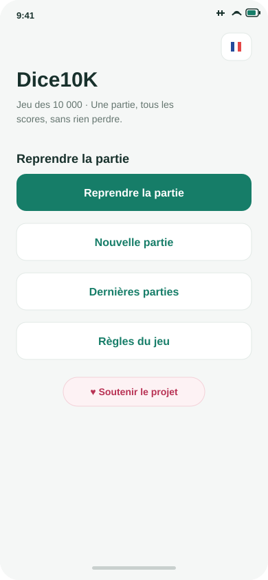
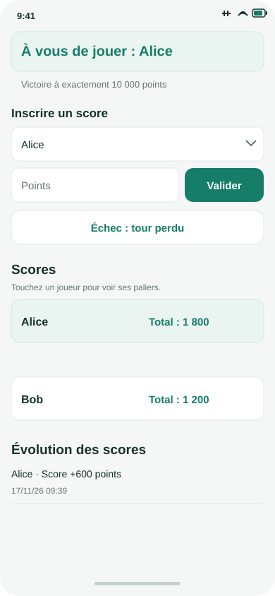
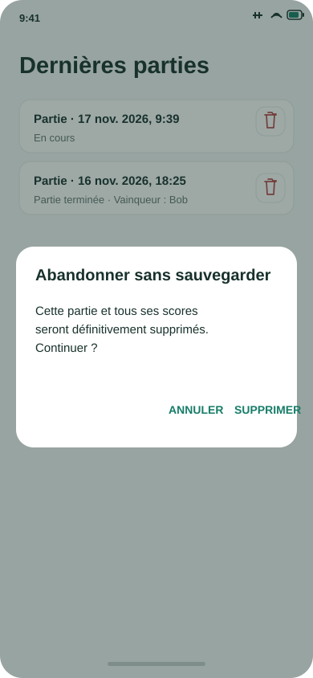

<p align="center">
  
</p>

<h1 align="center">Dice10K</h1>

<p align="center">
  <strong>L’application Android libre, légère et 100 % hors ligne pour suivre vos parties du jeu des 10 000.</strong>
</p>

<p align="center">
  <a href="https://github.com/furcy75/Dice10k/releases/latest">
    
  </a>
  <a href="https://github.com/furcy75/Dice10k/actions/workflows/build-release.yml">
    
  </a>
  <a href="./LICENSE">
    
  </a>
  
  
</p>

<p align="center">
  <a href="https://github.com/sponsors/furcy75">
    
  </a>
  <a href="https://ko-fi.com/furcy75">
    
  </a>
</p>

<p align="center">
  <a href="#-télécharger-et-installer-lapk">Télécharger l’APK</a> ·
  <a href="#-aperçu">Aperçu</a> ·
  <a href="#-fonctionnalités">Fonctionnalités</a> ·
  <a href="#-règles-prises-en-charge">Règles</a> ·
  <a href="#-compiler-depuis-les-sources">Compiler</a> ·
  <a href="#-contribuer">Contribuer</a> ·
  <a href="#-soutenir-le-projet">Soutenir</a>
</p>

---

**Dice10K** accompagne vos parties réelles de dés (jeu des 10 000 / *Farkle* / *Zilch*) autour de la table. Les joueurs lancent de vrais dés et saisissent leurs points : l’application gère automatiquement les totaux, l’ouverture à 600 points, les paliers, les 3 échecs, le vol de points en cascade et la victoire à exactement **10 000 points**.

- **Ultra-léger** : ~50 Ko, écrit en Java Android natif sans aucune dépendance externe.
- **Respectueux de la vie privée** : **zéro permission système**, zéro publicité, zéro pistage, 100 % hors ligne.
- **Logiciel libre** : code source ouvert sous licence GNU GPL v3.

---

## 📥 Télécharger et installer l’APK

<p align="center">
  <a href="https://github.com/furcy75/Dice10k/releases/latest">
    
  </a>
</p>

### Installation directe sur Android
1. Rendez-vous sur la page **[Releases](https://github.com/furcy75/Dice10k/releases/latest)** et téléchargez le fichier `Dice10K-v*.apk`.
2. Ouvrez le fichier téléchargé depuis votre téléphone.
3. Si Android le demande, autorisez l’installation d’applications depuis cette source (*« Sources inconnues »*).
4. *(Optionnel)* Vous pouvez vérifier l’intégrité du fichier grâce à son empreinte `.sha256` jointe à chaque release.

### Installation via ADB (ordinateur)
```sh
adb install -r Dice10K-v1.0.0.apk
```

---

## 📱 Aperçu

<p align="center">
  
  
  
</p>

---

## ✨ Fonctionnalités

| Fonctionnalité | Détail |
|---|---|
| **2 à 8 joueurs** | Choix rapide du nombre de joueurs et personnalisation des noms. |
| **Suivi complet des tours** | Saisie d’un score, enregistrement d’un échec ou correction manuelle (points négatifs). |
| **Paliers & 3 échecs** | Suivi automatique des croix par palier et retrait automatique du palier au 3e échec. |
| **Vol de points en cascade** | En cas d’égalité exacte, retrait du dernier gain de l’adversaire et résolution en cascade avec récapitulatif détaillé. |
| **Victoire à 10 000 exacts** | Dépassement refusé et compté comme échec ; clôture propre de la partie avec affichage du vainqueur. |
| **Historique & reprise** | Reprise instantanée de la partie en cours, consultation du détail par joueur, annulation d’une saisie et gestion des anciennes parties. |
| **Multilingue** | Interface et règles intégrées en **Français**, **English** et **Español** (bouton drapeau sur l’accueil). |
| **100 % hors ligne** | Base SQLite locale, aucune connexion requise. |

---

## 📜 Règles prises en charge

Le jeu des 10 000 connaît de nombreuses variantes locales : mettez-vous d’accord sur les combinaisons avant de démarrer. Voici les règles appliquées par l’application :

- **Ouverture à 600 points** : il faut marquer au moins **600 points en un tour** pour entrer dans la partie (ou rouvrir si le score retombe à 0 ou moins).
- **Victoire exacte à 10 000 points** : dépasser 10 000 annule les points du tour et compte comme un échec.
- **Règle des 3 échecs** : les croix sont attachées au palier en cours ; au 3e échec sur ce palier, son gain est retiré.
- **Égalité & vol de points** : rejoindre exactement le total d’un adversaire lui retire son dernier gain réussi, en cascade si une nouvelle égalité survient (un même gain ne peut être retiré qu’une seule fois).

👉 Consultez les règles détaillées en français, anglais et espagnol dans **[REGLES.md](./REGLES.md)**.

---

## 🛠️ Compiler depuis les sources

### Prérequis
- **JDK 17** (ou 21)
- **Android SDK** avec **Android SDK Platform 35**

### Commandes
```sh
git clone https://github.com/furcy75/Dice10k.git
cd Dice10k
./gradlew assembleDebug
```

Sous Windows :
```powershell
.\gradlew.bat assembleDebug
```

L’APK généré se trouve dans :
```text
app/build/outputs/apk/debug/app-debug.apk
```

### Architecture du projet
```text
Dice10k/
├── app/src/main/
│   ├── java/fr/jeudes10000/
│   │   ├── MainActivity.java    # Interface complète et gestion des écrans
│   │   └── GameDatabase.java    # Base SQLite et moteur des règles (paliers, égalités, cascades)
│   └── res/                     # Ressources, thème et icônes vectorielles
├── .github/
│   ├── FUNDING.yml              # Bouton Sponsor natif GitHub (Sponsors + Ko-fi)
│   └── workflows/
│       └── build-release.yml    # Compilation CI & publication automatique de l’APK
├── screenshots/                 # Illustrations vectorielles et logo
├── REGLES.md                    # Règles du jeu (FR / EN / ES)
├── CONTRIBUTING.md              # Guide de contribution
└── LICENSE                      # Licence GNU GPL v3
```

---

## 🔒 Confidentialité

Dice10K ne demande **aucune permission Android** (même pas l’accès à Internet).
Les noms des joueurs, les scores et l’historique restent stockés uniquement dans la base de données locale de l’appareil. Le bouton *« Soutenir le projet »* ouvre simplement votre navigateur par défaut si vous choisissez de cliquer dessus.

---

## 💖 Soutenir le projet

Dice10K est et restera **gratuit, libre et sans publicité**.
Si l’application anime vos soirées dés et que vous souhaitez encourager son développement, vous pouvez contribuer de plusieurs façons :

- ⭐ Mettre une **étoile** sur ce dépôt GitHub ;
- 💖 Soutenir via **[GitHub Sponsors](https://github.com/sponsors/furcy75)** ;
- ☕ Offrir un café sur **[Ko-fi](https://ko-fi.com/furcy75)** ;
- 🐛 Signaler un bug, proposer une amélioration ou ajouter une traduction !

---

## 🤝 Contribuer

Toutes les contributions sont les bienvenues (correctifs, tests unitaires, nouvelles langues, améliorations d’accessibilité ou variantes de règles).
Consultez **[CONTRIBUTING.md](./CONTRIBUTING.md)** pour démarrer, ou ouvrez une [issue](https://github.com/furcy75/Dice10k/issues) / [pull request](https://github.com/furcy75/Dice10k/pulls).

---

## 📄 Licence

Ce projet est distribué sous la licence **[GNU General Public License v3.0 (GPL-3.0)](./LICENSE)**.
Vous êtes libre de l’utiliser, l’étudier, le modifier et le redistribuer selon les termes de cette licence.
